<div align="center">

# LongVideo Memory-DMD

### Teacher adaptation and counterfactual control for long-video Memory-DMD

[](https://www.python.org/)
[](https://huggingface.co/Wan-AI/Wan2.1-T2V-1.3B)
[](#method)
[](https://huggingface.co/datasets/APRIL-AIGC/UltraVideo-Long)
[](#project-status)

This repository studies two complementary ways to make memory supervision
reliable in long-video DMD: adapt the AR teacher to the deployed long-history
cache, or control the history counterfactual without fine-tuning the teacher.
It includes 15-second inference and locked VBench reproduction tools.

[Method](#method) · [Quick start](#quick-start) · [AR teacher](#long-history-ar-teacher) ·
[DMD experiments](#memory-dmd-experiments) · [Evaluation](#evaluation) ·
[Full handoff guide](docs/ULTRAVIDEO_LONG_5K.md)

</div>

---

## Why this project

Long-video autoregressive generation exposes a recurring trade-off:

- stronger history conditioning improves subject and background consistency;
- an overly broad memory correction can suppress genuinely new motion;
- a short-context AR teacher cannot reliably supervise behavior outside its
  original temporal domain.

The original history-vs-empty residual combines two failure modes: its history
branch can be out of distribution for a five-second AR teacher, and removing all
history changes identity, local motion, and the video start-state prior at once.
This repository separates those causes instead of treating “memory strength” as
the only variable.

Our goal is to improve long-range identity and scene consistency **without
turning the video into a static continuation of its recent state**.

## Method

### 1. Problem: unreliable history-vs-empty supervision

The original memory residual compares an AR teacher with full history against
the same teacher without history:

```text
m_raw = A18 - A0
```

This counterfactual is not clean: removing all history changes identity,
local motion, and the start-state prior at the same time.

### 2. Route A: Long-vs-Local without AR-teacher fine-tuning

We instead compare full history with a recent local history:

```text
A18  = AR(current noisy chunk | 18 latent history frames)
A6   = AR(current noisy chunk |  6 recent latent history frames)
m_LR = A18 - A6
```

`A6` keeps roughly 1.4 seconds of recent motion evidence. The difference
therefore measures the marginal contribution of the older 12 latent frames
instead of conflating all history with an empty start state.

The memory-adjusted teacher target is constructed before the original DMD
normalizer:

```text
B* = B_BiWan + λ · s(t) · (A18 - A6)
```

The current implementation supports both ungated memory and a timestep gate
`s(t) = 1[t < 750]`. Full and local branches use identical current chunks,
noise, timesteps, text conditions, and current-query RoPE positions. The
six-frame branch is prefetched from an empty cache so it cannot leak the older
12 frames through cached keys and values.

This route is **AR-teacher-finetuning-free**, not fully training-free: the DMD
student still has to be trained with the Long-vs-Local residual.

### 3. Route B (main): adapted long AR teacher with basic mem1

The main route first makes the history branch in-distribution. The AR teacher is
fine-tuned on a 63-latent timeline while using exactly the cache it will see at
deployment:

```text
sink3 + recent15 + current3 noisy latents
```

Absolute RoPE positions remain on the full 63-latent timeline. After teacher
fine-tuning, the first controlled DMD experiment returns to the simplest mem1:

```text
m_tuned = A_long(sink3 + recent15) - A_long(empty)
```

It uses scale 1, the senior nonorm behavior, and every DMD timestep. It contains
neither `t < 750` nor Long-vs-Local. Those remain separate fallback ablations,
so a positive result can be attributed to teacher adaptation rather than a
mixture of three changes.

### 4. End-to-end pipeline

The repository provides an end-to-end pipeline for fine-tuning the AR teacher on
15-second UltraVideo-Long clips:

```mermaid
flowchart LR
    A["UltraVideo-Long metadata"] --> B["Locked 5K selection"]
    B --> C["Resumable video download"]
    C --> D["249 frames · 16 fps"]
    D --> E["Wan VAE · 63 latents"]
    E --> F["Atomic latent shards"]
    F --> G["LMDB"]
    G --> H["Long-history AR teacher fine-tuning"]
    H --> I["Memory-DMD experiments"]
    I --> J["15 s VBench"]
```



## Project status

- [x] Reproduce senior baseline and `mem1_nonorm` training protocols.
- [x] Implement A18−A6 with absolute RoPE alignment and clean local prefill.
- [x] Support joint normalization and optional `t < 750` gating.
- [x] Lock 15-second generation to 63 latent / 249 pixel frames at 16 fps.
- [x] Build official-prompt VBench evaluation for seven quality dimensions.
- [x] Build deterministic UltraVideo-Long 5K download and preprocessing.
- [x] Pass a real-data, one-GPU, two-step AR-teacher smoke test.
- [ ] Fine-tune the long-history AR teacher on the full 5K subset.
- [ ] Run ungated mem1 from the new sink/recent AR teacher.
- [ ] Keep A18−A6 and `t < 750` as separate fallback ablations.
- [ ] Select the final consistency–dynamics operating point.

## Quick start

### Environment

```bash
git clone --branch main --single-branch https://github.com/Chengzhi-W/LongVideo.git
cd LongVideo

conda create -n longvideo python=3.10 -y
conda activate longvideo
pip install -r requirements.txt
pip install git+https://github.com/openai/CLIP.git
pip install flash-attn --no-build-isolation
python setup.py develop
```

### Base models

The validated main route in this repository uses the **1.3B Wan model for all
three roles**: the student backbone, the BiWan real-score model, and the AR
teacher. Download these artifacts before preprocessing or training:

```bash
hf download Wan-AI/Wan2.1-T2V-1.3B \
  --local-dir wan_models/Wan2.1-T2V-1.3B

hf download zhuhz22/Causal-Forcing chunkwise/ar_diffusion.pt \
  --local-dir checkpoints

hf download zhuhz22/Causal-Forcing chunkwise/causal_ode.pt \
  --local-dir checkpoints
```

The AR-teacher pipeline expects the first two paths; the downstream DMD run
also needs `causal_ode.pt`:

```text
wan_models/Wan2.1-T2V-1.3B/Wan2.1_VAE.pth
checkpoints/chunkwise/ar_diffusion.pt
checkpoints/chunkwise/causal_ode.pt
```

The 14B checkpoint is **not required** for the senior chunkwise protocol or the
main long-AR-teacher experiment: both explicitly set
`real_name: Wan2.1-T2V-1.3B`. Some retained upstream/reference configs,
including `configs/causal_forcing_dmd_chunkwise.yaml` and the framewise DMD
configs, still use `Wan2.1-T2V-14B`. Download it only if you intentionally run
one of those configs:

```bash
hf download Wan-AI/Wan2.1-T2V-14B \
  --local-dir wan_models/Wan2.1-T2V-14B
```

Always check the selected YAML's `real_name` before downloading large model
weights. Changing the main config from 1.3B to 14B is an experiment change, not
a missing setup step.

## Long-history AR teacher

The full operator guide is
[`docs/ULTRAVIDEO_LONG_5K.md`](docs/ULTRAVIDEO_LONG_5K.md). The commands below
are the shortest safe path.

The teacher is fine-tuned on a 63-latent timeline with the same bounded cache
used at inference. Each mature three-latent target chunk attends to the first
three latent frames (the attention sink), the immediately preceding 15 latent
frames, and its own three noisy frames: `sink3 + recent15 + current3`. Absolute
RoPE positions are preserved across the full timeline; this is not full-history
attention.

### One-GPU preflight

The smoke test keeps all 63 latent frames while reducing spatial resolution.
It validates real video decoding, VAE encoding, LMDB loading, model loading,
the exact sink/recent attention topology, forward/backward, optimizer updates,
and checkpoint serialization.

```bash
DEBUG_COUNT=4 bash tools/ultravideo_long_5k.sh debug-download
bash tools/ultravideo_long_5k.sh debug-encode
bash tools/ultravideo_long_5k.sh debug-build
bash tools/run_ar_teacher_ultravideo_long_smoke_1gpu.sh
```

### Full 5K preparation

```bash
# Download metadata or the complete locked subset. Both are resumable.
bash tools/ultravideo_long_5k.sh metadata
bash tools/ultravideo_long_5k.sh download

# 249 pixel frames -> 63 Wan latents, then atomic LMDB packing.
NPROC_PER_NODE=8 bash tools/ultravideo_long_5k.sh encode-long
bash tools/ultravideo_long_5k.sh build-long
```

### Two-node / 16-GPU training

The production configuration is open-ended. It does **not** force a maximum
step; checkpoints are written every 100 steps and the operator chooses when to
stop. The locked topology is 2 nodes × 8 GPUs, batch 1 per GPU, global batch 16,
seed 42.

```bash
export WANDB_API_KEY=<your-key>

# Node 0
NODE_RANK=0 MASTER_ADDR=<node-0-ip> \
  bash tools/run_ar_teacher_ultravideo_long_2k_multinode.sh

# Node 1
NODE_RANK=1 MASTER_ADDR=<node-0-ip> \
  bash tools/run_ar_teacher_ultravideo_long_2k_multinode.sh
```

The launcher resolves the repository root automatically, so the clone may be
placed anywhere as long as checkpoints and LMDB use the documented relative
paths. The AR trainer does not implement gradient accumulation. The launcher
therefore rejects a world-size/global-batch mismatch before loading model
weights. An 8-GPU run needs an explicitly reviewed config with global batch 8
(or a separately validated per-GPU batch 2); it is not the same locked protocol
as the 16-GPU run.

## Memory-DMD experiments

| Experiment | Memory signal | Gate | Main config |
|---|---|---:|---|
| Baseline | none | — | `configs/causal_forcing_dmd_chunkwise_senior_baseline.yaml` |
| Senior mem1 | A18−A0 | none | `configs/causal_forcing_dmd_chunkwise_senior_mem1_nonorm.yaml` |
| **Long-teacher mem1 (main)** | A_sink+recent−A0 | **none** | `configs/causal_forcing_dmd_chunkwise_long_ar_teacher_mem1_ungated.yaml` |
| Long-vs-Local | A18−A6 | none | `configs/causal_forcing_dmd_chunkwise_long_vs_local_joint_nogate_step1500.yaml` |
| Long-vs-Local gated | A18−A6 | `t < 750` | `configs/causal_forcing_dmd_chunkwise_long_vs_local_joint_t750.yaml` |
| Gated open-ended | A18−A6 | `t < 750` | `configs/causal_forcing_dmd_chunkwise_long_vs_local_joint_t750_openended.yaml` |

Before launching the main DMD experiment, install the selected teacher
checkpoint at the path in its config and run:

```bash
python tools/audit_long_teacher_mem1_config.py \
  --config configs/causal_forcing_dmd_chunkwise_long_ar_teacher_mem1_ungated.yaml
```

All comparison runs should keep the initial checkpoint, seed, global batch,
prompt stream, frame count, and checkpoint selection fixed.

## Evaluation

Our locked comparison protocol is:

- checkpoint: EMA at the selected training step;
- video length: 63 latent / 249 pixel frames, 16 fps;
- inference seed: 0 on every rank, with no rank seed offset;
- generation: 8 GPUs, batch size 4, prompt batch stream;
- metrics: Subject Consistency, Background Consistency, Temporal Flickering,
  Motion Smoothness, Aesthetic Quality, Imaging Quality, Dynamic Degree;
- official prompt groups: Subject `72×5`, Temporal Flickering `75×5`, Scene
  `86×5`, Overall `93×5`;
- quality aggregation: official normalization bounds, Dynamic weight `0.5`,
  all other dimensions weight `1.0`.

Useful entry points:

```text
tools/vbench_generate.py
tools/run_vbench_dimensions.sh
tools/calc_vbench_quality_no_tf.py
tools/run_vbench_lrl_t750_step600_seed0_quality7.sh
```

### Current reference snapshot

This table records the earlier AR-teacher-finetuning-free ablation, not a result
for the new adapted-teacher main route. All three runs use the same 15-second,
all-rank seed-0 VBench protocol. It shows that counterfactual control and the
optional gate can recover the consistency–dynamics balance without tuning the
old teacher; the tuned-teacher mem1 result is still pending.

| Metric | Baseline step600 | A18−A6 ungated | A18−A6 `t < 750` |
|---|---:|---:|---:|
| Subject Consistency | 92.57 | 93.21 | **93.45** |
| Background Consistency | 93.79 | **94.70** | 94.27 |
| Temporal Flickering | **99.05** | 99.01 | 99.04 |
| Motion Smoothness | 98.42 | **98.81** | 98.38 |
| Aesthetic Quality | 67.20 | 67.31 | **67.32** |
| Imaging Quality | **70.83** | 70.10 | 70.49 |
| Dynamic Degree | 72.22 | 58.06 | **76.67** |
| Quality6 (no TF) | 82.27 | 81.47 | **82.91** |
| Quality7 | 84.60 | 83.91 | **85.14** |

## Repository layout

```text
LongVideo/
├── configs/                 training and experiment configurations
├── data_manifests/          versioned UltraVideo-Long 5K selection
├── docs/                    handoff and reproduction documentation
├── model/                   DMD and diffusion objectives
├── pipeline/                training and inference pipelines
├── trainer/                 distributed trainers
├── utils/                   datasets, distributed helpers, Wan wrappers
├── wan/                     causal Wan model and attention implementation
├── tools/                   data, training, inference, and VBench entry points
├── prompts/                 locked evaluation manifests
└── long_video/              packaged/mirrored long-video modules
```

The root modules are the validated execution path used by every handoff command
in this README. The `long_video/` tree is an upstream compatibility snapshot;
do not launch the new AR-teacher or Memory-DMD experiments from that subtree.

## Reproducibility and artifact policy

The repository tracks code, configs, prompts, deterministic selection IDs, and
documentation. It intentionally excludes:

- raw UltraVideo-Long videos and downloaded ZIP archives;
- VAE latent shards and LMDB databases;
- model checkpoints, generated videos, VBench outputs, and W&B logs;
- API keys, SSH credentials, and local environment files.

Before publishing or sharing derived data, verify the current UltraVideo-Long
license and the underlying source-video terms. Never commit credentials; all
launch scripts read W&B authentication from `WANDB_API_KEY`.

## Validated handoff

The AR-teacher path was debugged on four real UltraVideo-Long clips and an
NVIDIA RTX PRO 6000 Blackwell GPU:

- four videos fully decoded, each longer than 15.6 seconds;
- exact smoke latent shape `(63, 16, 30, 52)`, FP16, all finite;
- four LMDB rows loaded with non-empty prompts;
- two complete 63-latent forward/backward optimizer steps;
- step-2 checkpoint matched all 825 initial model keys;
- all 825 tensors changed and remained finite after optimization.

On Blackwell, the fixed FlexAttention Triton schedule exceeded per-block shared
resources. The handoff launchers therefore default to
`max-autotune-no-cudagraphs`, which selected valid equivalent forward and
backward kernels.

This validates the one-GPU code path and checkpoint format. It does not claim
that a full 5K/2K-step run has completed, that the two-node collective path has
already been exercised end to end, or that the tuned-teacher mem1 quality result
is known. Those are the next production experiments.

## Acknowledgements

This project builds on:

- [Causal Forcing](https://github.com/thu-ml/Causal-Forcing)
- [Wan2.1](https://github.com/Wan-Video/Wan2.1)
- [UltraVideo-Long](https://huggingface.co/datasets/APRIL-AIGC/UltraVideo-Long)
- [VBench](https://github.com/Vchitect/VBench)

Please follow the upstream licenses and citation requirements when using or
redistributing the corresponding code, models, datasets, or evaluation tools.
